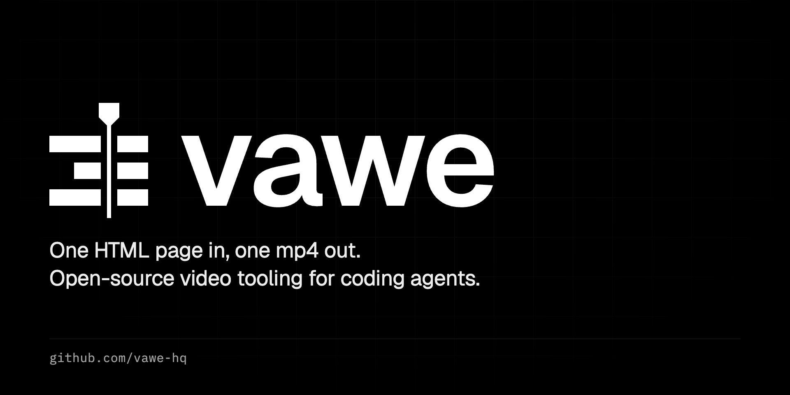

<p align="center">
  <a href="https://vawe.dev"></a>
</p>

<p align="center">
  <a href="https://github.com/vawe-hq/vawe/blob/main/LICENSE"></a>
  <a href="https://github.com/vawe-hq/vawe/stargazers"></a>
</p>

<p align="center"><b>One HTML page in, one mp4 out. Video tooling for coding agents.</b></p>

<p align="center">
  <a href="https://vawe.dev">vawe.dev</a> |
  <a href="https://vawe.dev/docs">Docs</a> |
  <a href="https://github.com/vawe-hq/vawe">vawe</a> |
  <a href="https://github.com/vawe-hq/skills">Skills</a>
</p>

Write one HTML page. vawe renders it to an mp4. You write the page, or a coding agent does.

The page is plain HTML, CSS, Web Animations, SVG, canvas or three.js. The renderer seeks it frame by
frame in headless Chrome under a virtual clock, so the same page gives the same frames on every run.

```bash
npm install @vawe/cli
npx vawe new my-film --request "a 10 second title card"
npx vawe dev films/my-film/page.html
```

| Repository | What it holds |
|---|---|
| [vawe](https://github.com/vawe-hq/vawe) | The framework: the renderer, the checks, the studio and the agent skills. npm package `@vawe/cli` |
| [vawe-site](https://github.com/vawe-hq/vawe-site) | vawe.dev: the website, the template gallery and the marketplace |
| [vawe-docs](https://github.com/vawe-hq/vawe-docs) | The documentation, served at vawe.dev/docs |
| [skills](https://github.com/vawe-hq/skills) | Six agent skills, `npx skills add vawe-hq/skills`. A mirror: change them in vawe |

Lists we keep from our own research, each entry with its source:

| List | What is in it |
|---|---|
| [awesome-agent-video](https://github.com/vawe-hq/awesome-agent-video) | Tools for making video with code and coding agents |
| [awesome-agent-skills-directories](https://github.com/vawe-hq/awesome-agent-skills-directories) | Where to list agent skills and plugins, and the rules for each |
| [awesome-ai-search-visibility](https://github.com/vawe-hq/awesome-ai-search-visibility) | What the evidence says about being named and cited by AI engines |

Start with the [quickstart](https://vawe.dev/docs/quickstart). To help, read [CONTRIBUTING](https://github.com/vawe-hq/.github/blob/main/CONTRIBUTING.md). vawe is Apache-2.0.
